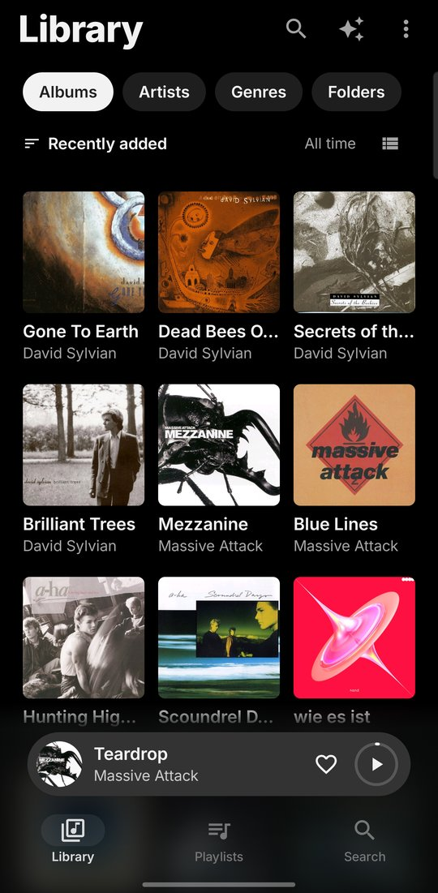
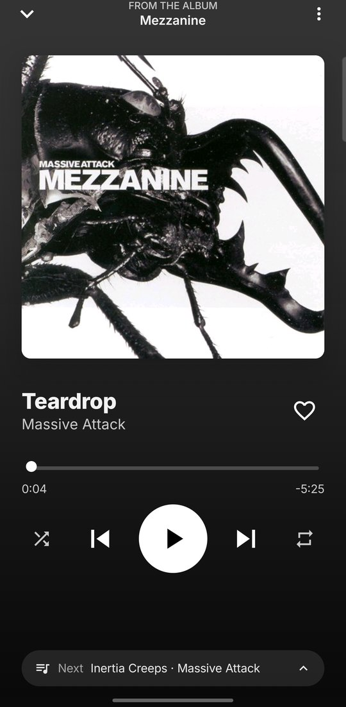
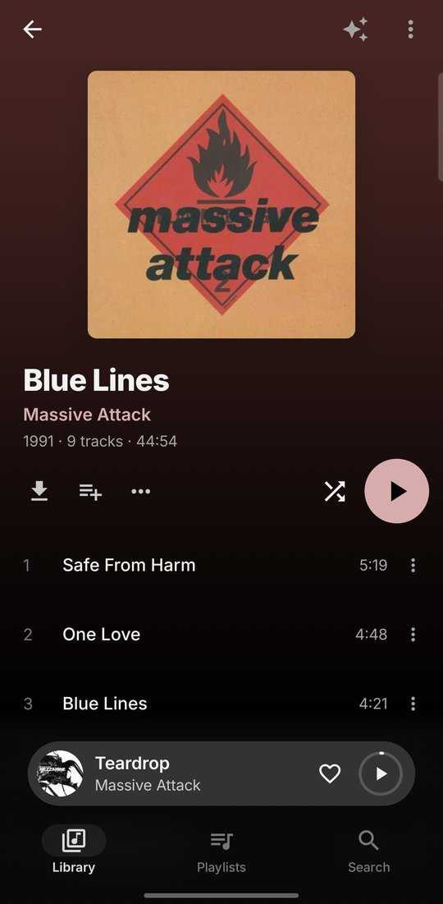
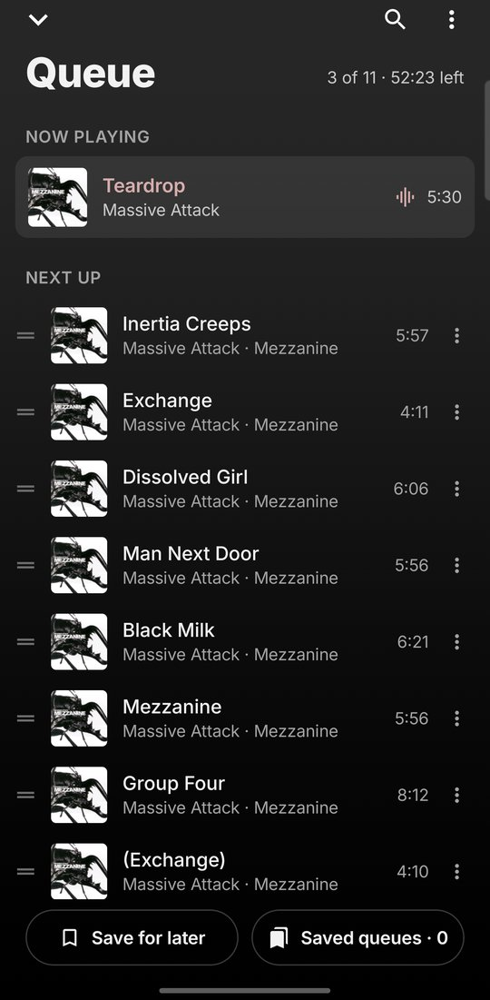
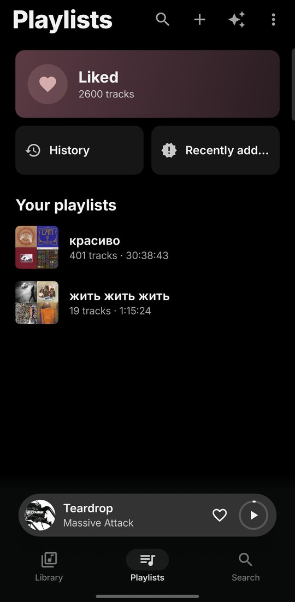
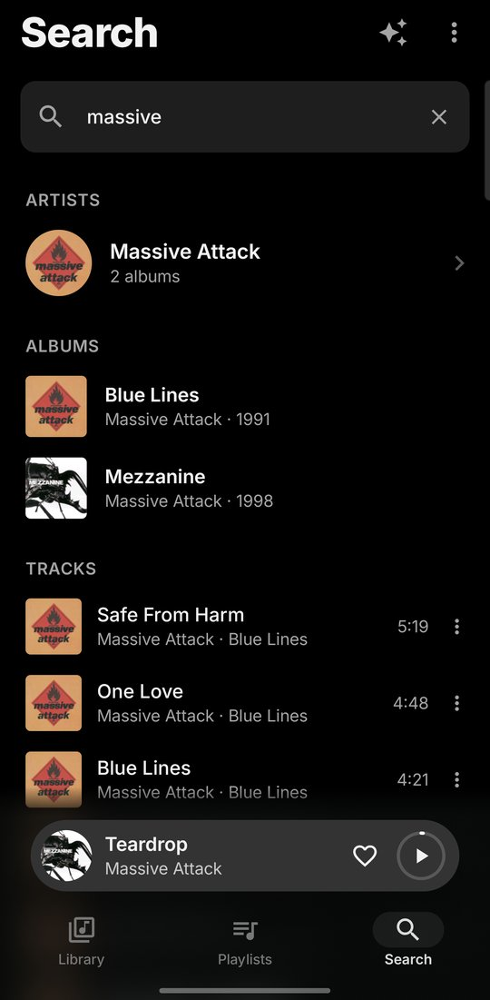

# b2-player

An Android music player for your own library stored in a Backblaze B2 bucket. The music sits in the
bucket as plain files (originals, no transcoding or encryption) and the player streams it straight
from B2. There is no server: the phone talks to B2 itself, and the catalog, covers and lyrics are
prepared in advance by a script on the computer that holds the library.

<p>
  
  
  
</p>
<p>
  
  
  
</p>

```
<bucket>/
  music/<same as the music folder>  originals: FLAC, MP3, M4A (ALAC), ...
  catalog.json.gz          catalog built from tags
  covers/<album-id>.jpg    512 px covers
  lyrics/<album-id>.json   lyrics from tags
  state/likes.json         likes (differences from the catalog's flags)
  state/playlists.json     playlists
  state/ratings.json       album ratings 1-10 (from the listening diary, and set in the app or cmus)
  state/history.tsv        listening history: time and track id
  state/now-playing.json   last track, queue and position on the phone or in cmus, for "Continue from arch"
  state/tags.json          tag edits made on the phone, not yet written to files
  logs/<date>.log          phone log after errors
```

With the B2 lifecycle rule "Keep all versions" the bucket doubles as a music backup: B2 keeps old
versions of every file.

## Library computer: upload and catalog

You need rclone with a remote for the bucket (a Read and Write key, e.g.
`rclone config create b2music b2 account … key …`), `python-mutagen` and `python-pillow`.
The scripts take their paths from environment variables:

| Variable | Meaning |
|---|---|
| `B2_PLAYER_REMOTE` | the bucket in rclone, e.g. `b2music:my-music` |
| `B2_PLAYER_MUSIC` | the music folder, `~/Music` by default |
| `B2_PLAYER_OUT` | where catalog builds and reports go, `~/.cache/b2-player` by default |

```bash
tools/sync-music.sh --dry-run          # show what would change
tools/sync-music.sh                    # upload new and changed files of the music folder -> music/
tools/sync-music.sh -- "rock/Artist"   # only these subfolders
tools/publish-catalog.sh               # catalog + covers, then check that every path exists in the bucket
tools/apply-tags.py                    # tag edits from the phone: what would change in the files
tools/apply-tags.py --apply            # write them to the files and drop them from state/tags.json
tools/sync-ratings.py                  # album ratings: what would change in the diary and state/ratings.json
tools/sync-ratings.py --apply          # write them (b2-ratings.timer runs this every 10 minutes)
```

`sync-music.sh` does not start while a restic backup is running on the machine, so the two don't
compete for disk and network; `WAIT_FOR_RESTIC=1` makes it wait instead.

The music folder may keep only part of the music: `sync-music.sh` never deletes from the bucket, and
`publish-catalog.sh` keeps the tracks that are still in the bucket in the catalog (with their old tags,
likes and lyrics). To remove an album from the bucket, or the old folder after a rename, use
`rclone purge "$B2_PLAYER_REMOTE/music/<folder>"`. Tag edits and `fetch-lyrics.py` only reach local files.

Tag editing: "Track info" in a track's menu → Edit. The phone puts edits into `state/tags.json`
(`{"tracks": {"<path>": {"GENRE": "…"}}}`, an empty value removes the tag) and shows them over the
file's own tags. `apply-tags.py --apply` writes them to the files with mutagen and prints the command
`sync-music.sh -- <folders> && publish-catalog.sh`. When a file's size changes in the catalog, the
phone drops its old copy from the stream cache.

Album ratings: the listening diary (`послушал <year>.md`, lines like `207. Youth of America (1981) - Wipers,
12.11.2026, 7/10`) is the source. `sync-ratings.py` matches its lines to catalog albums by artist and title
(also without `(edition)`/`[label]` parts and with small typos), the last rating of an album wins, and
uploads `state/ratings.json` (`{"albums": {"<album-id>": {"rating": 7}}}`). A rating set on the phone or
in cmus goes there as `{"rating": 8, "time": <ms>, "pending": true}`; the script appends it to the diary
as a new line in the same format and then reads it back like the others. Unmatched diary lines are in
`~/.cache/b2-player/ratings-unmatched.txt`; `~/.config/b2-player/rating-aliases.tsv`
(`artist<TAB>title<TAB>album-id`, as written in the diary) names their albums by hand.

`make_catalog.py`:
- groups tracks into albums by folder (`CD1`/`Disc 2` merge into the parent), and within a folder by the album tag;
- fixes cp1251 tags that were written as latin1;
- splits "one file + CUE" rips into tracks (`start` + `duration`, clipped in the player);
- the cover is a cover/folder/front file in the folder, otherwise the first image, otherwise the embedded one;
- if the `--favourites` folder exists (`~/Favourite Music` by default), marks tracks that are also in it
  as liked and writes the ones it can't match to `unmatched-favourites.txt`. Handy if favourites used to be
  copied into a separate folder; that folder is not uploaded.

## Phone

Kotlin + Jetpack Compose + Media3 (ExoPlayer, `MediaSessionService` for background playback and the notification).
ALAC and anything else the platform can't decode goes through `org.jellyfin.media3:media3-ffmpeg-decoder`.

- B2 access: `b2_authorize_account` (native API), then GET `…/file/<bucket>/<key>` with the token.
- Stream cache: 4 GB SimpleCache, LRU; the cache key is a `b2://` URI, independent of the token.
- Offline: "Offline" on an album or "Download" in Liked downloads whole files (WorkManager).
- Likes live in the bucket in `state/likes.json` as differences from the catalog's flags (`added`/`removed`).
  Every tap on the heart is uploaded right away; on start the app pulls the file from the bucket unless the
  phone has changes that aren't uploaded yet. That's why the phone's key needs write access.

- Continue listening: on play, pause and track change the phone writes the track, the queue from it on
  (up to 200 tracks, in play order) and the position to `state/now-playing.json` (cmus does the same with
  `contrib/cmus-b2-now` in the cmus fork). When cmus played after the phone, a "Continue from arch" bar above
  the mini player resumes that queue at that position, with shuffle off.

- Playlists, `.m3u` import (e.g. from Musicolet): tracks are matched by file name and folder, then by `#EXTINF` "artist - title".
- A play counts after half the track or 4 minutes (tracks shorter than 30 s don't count); the same rule applies
  to history and Last.fm scrobbling; likes and unlikes go to Last.fm as love/unlove. The Last.fm API key and
  login are entered in Settings → Accounts, the password is not stored.

- Assistant (the ✦ button in the top bar): a chat with Claude, by text or voice. The Claude API key is entered in
  Settings → Accounts and requests go from the phone straight to the API. It finds and plays music and answers questions
  about listening history; changes to likes and playlists apply only after "Apply". The conversation lasts
  until the app is closed. The same assistant runs in cmus on the computer (`cmus-b2-ask`, see Assistant in cmus below).

- Lyrics: from file tags (the catalog puts them in `lyrics/<album-id>.json`). The app goes to lrclib.net only when
  the tags have no synced lyrics, and saves what it finds to `found-lyrics/` in the bucket. `tools/fetch-lyrics.py`
  looks up synced lyrics on lrclib.net for the whole library (tracks without lyrics first, then ones with unsynced
  lyrics) and with `--apply` writes them into the tags together with what the phone found; without the flag it
  only searches and writes a `lyrics-report.txt` report to `B2_PLAYER_OUT`. An interrupted run resumes where it
  stopped. Afterwards run `tools/sync-music.sh && tools/publish-catalog.sh`.
  The translate button in lyrics: Claude (with the assistant's key) translates the song line by line into English
  or Russian, shown next to the original. Cached per track and language in `files/lyrics-translations`.
- Logs: `files/logs/app.log` in the app, rotated at 512 KB, ~1.5 MB at most. After errors they are copied
  to the bucket as `logs/<date>.log` (one version per day). To read them:
  `rclone cat <remote>:<bucket>/logs/<date>.log` or
  `adb logcat -s 'B2P/*'` (the same lines go to logcat; `run-as` only works with a debug build).

## Install

A ready arm64 APK (Android 10+) is in [Releases](../../releases/latest). On first launch, enter the B2 key's
keyID and applicationKey and the bucket name in Settings → Accounts (it opens by itself). The key needs Read and Write access so that likes,
playlists and history can sync.

Build (JDK 21, Android SDK):

```bash
./gradlew assembleRelease && adb install -r app/build/outputs/apk/release/app-release.apk
```

Install the release build: the debug build is several times slower (catalog parsing ≈1 s instead of
≈0.16 s, startup ≈470 ms instead of ≈200 ms). Both are signed with the debug key, so switching between
them keeps the app's data.

The version is `baseVersion.N` (e.g. 0.5.35), where N is the number of commits in `HEAD`. The versionCode is the
commit time of `HEAD` in minutes, so it keeps growing after a squash merge.
Every push to main publishes a `vX.Y.N` release on GitHub Releases. CI signs it with the debug key from the
`DEBUG_KEYSTORE` secret (the keystore in base64), so releases install over local builds. Bump `baseVersion` in
`app/build.gradle.kts` when shipping notable features.

## Assistant in cmus

`core/` holds the assistant itself: the prompt, the tools and the conversation with Claude. The app (`Assistant.kt`) and
`cli/`, a terminal chat for [cmus](https://github.com/buyolitsez/cmus), only give it the player: what plays, the queue,
likes, playlists and history. A change to the assistant in `core/` works on the phone and in cmus alike.

`cmus-b2-ask` plays in a running cmus through `cmus-remote`, the tracks named as `contrib/cmus-b2` of the cmus fork adds
them, and reads and writes `state/*` in the bucket with rclone (`b2music:buyolitsez-music`). Likes and playlists are changed
on top of the bucket copy after `y`. The key is `ANTHROPIC_API_KEY=...` in `~/.config/cmus-b2/env`; the log goes to
`~/.cache/cmus-b2/assistant.log`. Install it on the computer with JDK 21 (no Android SDK needed):

```bash
./gradlew --configure-on-demand :cli:installDist && rm -rf ~/.local/opt/cmus-b2-ask && cp -r cli/build/install/cmus-b2-ask ~/.local/opt/
```

and run it with `contrib/cmus-b2-ask` of the cmus fork.
